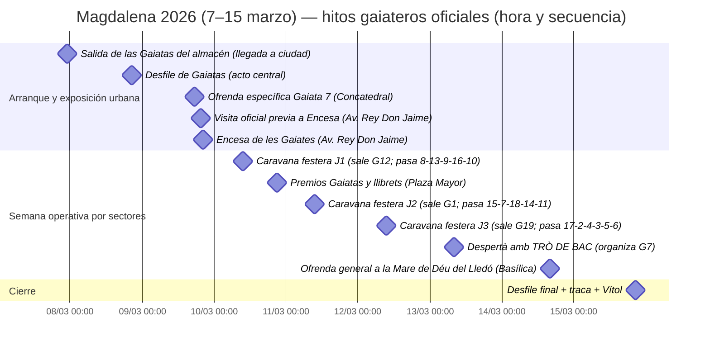
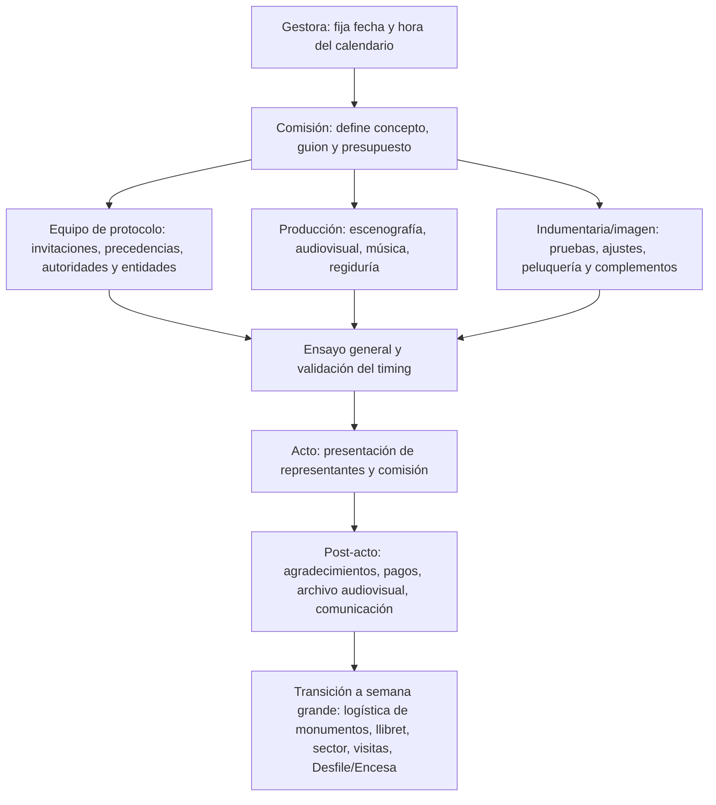

# Fiestas de la Magdalena de Castelló centrado en las Gaiatas  
**Fecha de referencia:** 10/03/2026 (Europa/Madrid)

## Resumen ejecutivo

Las **gaiatas** constituyen el **símbolo identitario central** de las Fiestas de la Magdalena: son **monumentos artísticos y efímeros** asociados a la “luz” que guía el mito fundacional del traslado desde el Castell Vell a la Plana, y articulan la ciudad en **19 sectores** (Gaiata 1 a 19) que funcionan como **asociaciones culturales de barrio**. Este papel no es solo “decorativo”: las comisiones asumen un **trabajo continuo a lo largo de todo el año** (diseño, construcción, organización social y cultural), concepto subrayado en la declaración patrimonial que integra la **Procesión de las Gaiatas** dentro del BIC inmaterial vinculado a la Romeria de les Canyes. citeturn17view4

En la **semana grande 2026 (7–15 marzo)**, el programa oficial (disponible en PDF) fija un conjunto de **hitos gaiateros con hora**: la **Salida de las Gaiatas del almacén** (07/03 23:00), el **Desfile de Gaiatas** (08/03 20:30), la **Visita oficial previa** (09/03 19:30) y la **Encesa de les Gaiates** (09/03 20:15), la **Entrega de premios de Gaiatas y llibrets** (10/03 21:00), la **VIII Caravana festera hacia la mascletà** (10–12/03 09:30, con recorrido por sectores concretos), la **Ofrenda general a la Mare de Déu del Lledó** (14/03 16:00) y el **cierre** con **Desfile final + traca + Vítol** (15/03 20:30 y continuación). citeturn4view0turn4view1turn4view2turn6view0turn7view0turn13view0

En **protocolo e indumentaria**, la fuente más sólida y “normativa” es el texto patrimonial: diferencia explícitamente entre **portadores** (ropa de **labrador/saragüells o labradora**) y **comitiva** (trajes festivos de **castellonera y castelloner**), y describe el funcionamiento ritual de la procesión, la ubicación por sectores y el ciclo anual de trabajo. citeturn17view4 Sin embargo, muchos detalles que el usuario solicita como “exactos” (p. ej., vestuario por acto para madrinas/infantiles, micro-protocolos de recepción, orden interno en presentaciones) **no están publicados de forma completa** en fuentes primarias abiertas; por rigor, se señalan como **“no especificado”** y se proponen vías de confirmación (Federación Gestora, Junta de Festes, cada comisión).

En profundidad, **“Brancal de la Ciutat”** es (a) un término constructivo/lingüístico con significado de **jamba/umbral** de un portal y (b) la denominación oficial de la **Gaiata 1**, cuyo propio relato de comisión vincula el nombre a un acceso histórico amurallado de la ciudad. Además, en 2026 el programa sitúa a la Gaiata 1 como **punto de salida** de una de las jornadas de la Caravana festera (11/03 09:30) y como **visita oficial** (13/03 17:45), reforzando su función pública y logística. citeturn9search0turn9search1turn9search3turn6view1turn12view3

## Marco analítico, fuentes y criterios de verificación

Este informe prioriza **fuentes primarias y oficiales en español** y, cuando no existe información oficial detallada, recurre a prensa local y comunicaciones sectoriales, marcando explícitamente el nivel de verificación. Las fuentes clave utilizadas son:

* **Texto patrimonial (BOE / Decreto 30/2024)**: describe la Procesión de las Gaiatas, su simbolismo, la estructura por sectores, el almacén municipal, el ciclo anual y criterios de indumentaria (portadores vs comitiva). Es la base más “normativa” para roles/protocolo. citeturn3view1turn17view4  
* **Programa oficial 2026 (PDF)**: aporta **horas y recorridos** de los actos, incluyendo los específicamente gaiateros y las visitas oficiales a gaiatas concretas. citeturn3view0turn4view1turn6view0turn13view0turn7view0  
* **Patronat de Festes (festescastello.es)**: marco institucional y catálogo de concursos (incluye “Concurso de llibrets” para Comisiones de Sector). citeturn1search0turn14view1  
* **Federación Gestora** (vía prensa): calendario y sentido de las presentaciones de sector en el Palau de la Festa. citeturn8view1turn8view2  
* **Prensa local** (El Mundo Castellón al día, elperiodic.com, Vive Castellón, Castellón Información, Actualidad Castellón, Onda Cero, etc.): detalles operativos (cambio de vestuario en el Homenaje, novedades de Galanía, normas del Pregó, cobertura de Encesa). Se usa con cautela y se triangula cuando hay contradicciones. citeturn18view1turn10view1turn10view3turn18view0turn1search2turn2search16

**Criterio de “exactitud”:** solo se presenta como “verificado” lo que aparece explícitamente en estas fuentes. Todo lo no cubierto se etiqueta como **no especificado** y/o se formula como **suposición razonable** (claramente marcada) basada en el marco ritual del BOE y en prácticas descritas por Junta/medios.

## El ciclo anual gaiatero y calendario por públicos

### Cómo se estructura el “año gaiatero” según fuentes primarias

El Decreto patrimonial explicita que la construcción y actividad asociativa de las comisiones se desarrolla **a lo largo de todo un año**: finalizadas las fiestas y desmontadas las gaiatas, comienzan los **esbozos** del año siguiente; además, la construcción actual la realizan **los propios asociados** siguiendo a un “artista gaiatero” (dirección creativa), no “profesionales externos” como norma general. citeturn17view4

También fija elementos estructurales de operación urbana: las gaiatas (mayor e infantil) se sitúan en **19 puntos estratégicos** de la ciudad asociados a cada sector, y reconoce como almacén municipal el antiguo matadero (referido como “almacén municipal de gaiatas”). citeturn17view4

### Calendario anual comparativo por tipo de público

La tabla siguiente organiza un **calendario anual completo “verificable”** (hitos que aparecen documentados) y, en paralelo, indica actividades típicas que las fuentes reconocen como parte del ciclo anual pero **sin fecha única** (p. ej., construcción en almacenes). Las filas “sin fecha única” se consideran **actividad continuada**.

| Ventana (ciclo anual) | Evento / actividad relacionada con gaiatas | Madrinas | Comisión (organizativa) | Mayores/adultos (participación social) | Infantiles |
|---|---|---:|---:|---:|---:|
| Marzo (post-fiestas) | Desmontaje y arranque de bocetos/diseño del año siguiente (actividad anual tras desmontaje) | no especificado | **Sí (núcleo)** | no especificado | no especificado |
| Todo el año | Construcción y preparación de monumentos (mayor/infantil), gestión de “cau”, ensayos y organización cultural del sector | indirecto | **Sí (núcleo)** | **Sí (participa)** | **Sí (si hay comisión infantil/escuela)** |
| Junio (ciclo 2025/26) | Reunión/decisión del **calendario de presentaciones** (Federación Gestora; reunión en Palau) | indirecto | **Sí** | no especificado | no especificado |
| Septiembre | **Imposición de bandas** (inicio del ciclo; incluye madrinas/presidentes infantiles de 19 gaiatas según prensa) | **Sí** | **Sí** | **Sí (asistencia/acompañamiento)** | **Sí** |
| Septiembre–febrero | **Presentaciones de sector** (19 comisiones; Palau de la Festa; con fecha y hora) | **Sí (rol central)** | **Sí (organiza)** | **Sí (asiste)** | **Sí (si hay corte/representantes infantiles)** |
| Finales de febrero | **Homenaje a Comisiones de Sector** (formato renovado; énfasis en trabajo anual) | **Sí** | **Sí** | **Sí** | **Sí (día infantil)** |
| Finales de febrero | Entrega/presentación de **llibrets** (acción conjunta de comisiones; y bases de entrega en Patronat con fechas) | indirecto | **Sí** | **Sí (público/ciudad)** | indirecto |
| Principios de marzo (previo a semana grande) | **Galanía** (acto de homenaje a la Reina; incluye presencia de madrinas/presidentes de gaiatas) | **Sí** | **Sí** | **Sí** | no especificado (según acto) |
| Semana grande (7–15 marzo 2026) | Hitos gaiateros: salida almacén, desfile, encesa, visitas oficiales, caravana, premios, ofrenda, cierre | **Sí** | **Sí** | **Sí** | **Sí** |
| Calendario escolar (Magdalena 2026) | Concurso escolar de **maquetas de gaiata** (organizado por Gaiata 15 Sequiol; bases con fechas de recogida 17–18/03/2026) | no especificado | **Sí (organiza sector 15)** | no especificado | **Sí (participa)** |

**Fuentes del calendario anual:** ciclo anual y desmontaje/inicio de esbozos (BOE) citeturn17view4; reunión de Gestora y sentido de las presentaciones citeturn8view1turn8view2; imposiciones de bandas y arranque de presentaciones (prensa) citeturn11view1turn8view0; homenaje a comisiones y reconocimiento del trabajo “meses y meses” anual citeturn10view3turn2search16turn18view1; concursos (Patronat) citeturn14view1; maquetas (bases Sequiol) citeturn2search3turn2search7; Galanía (1/03/2026) citeturn10view1turn10view0

### Calendario de presentaciones 2025/26 por Gaiata (fecha y hora)

La siguiente tabla está transcrita de la nota publicada (en valenciano) con el calendario 2025/26 y es útil para planificación de madrinas/comisiones.

| Fecha | Acto | Hora |
|---|---|---:|
| 20/09/2025 | Presentació Gaiata 3 | 23:00 |
| 27/09/2025 | Presentació Gaiata 4 | 23:00 |
| 04/10/2025 | Presentació Gaiata 10 | 23:00 |
| 11/10/2025 | Presentació Gaiata 17 | 20:00 |
| 18/10/2025 | Presentació Gaiata 2 | 20:00 |
| 25/10/2025 | Presentació Gaiata 15 | 23:00 |
| 01/11/2025 | Presentació Gaiata 13 | 23:00 |
| 08/11/2025 | Presentació Gaiata 11 | 23:00 |
| 15/11/2025 | Presentació Gaiata 8 | 20:00 |
| 22/11/2025 | Presentació Gaiata 12 | 20:00 |
| 29/11/2025 | Presentació Gaiata 9 | 23:00 |
| 06/12/2025 | Presentació Gaiata 6 | 20:00 |
| 13/12/2025 | Presentació Gaiata 1 | 20:00 |
| 20/12/2025 | Presentació Gaiata 7 | 20:00 |
| 10/01/2026 | Presentació Gaiata 14 | 23:00 |
| 17/01/2026 | Presentació Gaiata 18 | 23:00 |
| 24/01/2026 | FITUR | no especificado |
| 31/01/2026 | Presentació Gaiata 19 | 23:00 |
| 07/02/2026 | Presentació Gaiata 16 | 23:00 |
| 14/02/2026 | Presentació Gaiata 5 | 23:00 |

**Fuente principal:** tabla reproducida en la publicación de calendario de presentaciones 2025/26. citeturn8view2

## Semana de la Magdalena 2026 con timing por día y obligaciones por Gaiata

### Cronograma mermaid de hitos gaiateros con hora



**Base de datos (horas/actos):** programa oficial (PDF) de Magdalena 2026. citeturn4view0turn4view1turn4view2turn6view0turn7view0turn13view0  
**Contexto adicional (Encesa con 19 gaiatas iluminadas):** cobertura local del 10/03/2026 sobre la Encesa “anoche” y la presencia de las 19 gaiatas ya luciendo en sectores. citeturn1search2

### Actos gaiateros por día y hora (7–15 marzo 2026)

La tabla siguiente recoge los actos donde el programa menciona explícitamente **gaiatas** como eje del acto, o las **visitas oficiales** a sectores, además de “puntos de control” relevantes para obligaciones (caravana, premios, ofrendas).

| Día | Hora | Acto | Participación (según programa) |
|---|---:|---|---|
| Sáb 07/03 | 23:00 | **Salida de las Gaiatas del almacén** y llegada a la ciudad | **Todas** (hito común de logística y arranque visual) |
| Dom 08/03 | 20:30 | **Desfile de Gaiatas** (recorrido por calles céntricas) | **Todas** (acto central) |
| Lun 09/03 | 17:30 | **Ofrenda de Flores de la Gaiata 7** a la Mare de Déu del Lledó (Concatedral) | Gaiata 7 (organiza; itinerario propio) |
| Lun 09/03 | 19:30 | **Visita oficial** a las gaiatas participantes en la Encesa (Av. Rey Don Jaime) | “Gaiatas participantes” (acto previo institucional) |
| Lun 09/03 | 20:15 | **Encesa de les Gaiates** (exaltación del monumento) | Gaiatas participantes (en práctica: sistema de 19 en exposición) |
| Mar 10/03 | 09:30 | **VIII Caravana festera** J1 hacia mascletà | Sale G12; pasa por sectores **8–13–9–16–10** |
| Mar 10/03 | 11:15 | Visita oficial a G18 | G18 (recepción sectorial) |
| Mar 10/03 | 17:00 | Visita oficial a G13 | G13 |
| Mar 10/03 | 18:00 | Visita oficial a G8 | G8 |
| Mar 10/03 | 19:00 | Visita oficial a G2 | G2 |
| Mar 10/03 | 21:00 | **Premios de Gaiatas y llibrets** (Plaza Mayor) | Todas (acto institucional competitivo/cultural) |
| Mié 11/03 | 09:30 | **VIII Caravana festera** J2 hacia mascletà | Sale G1; pasa por **15–7–18–14–11** |
| Mié 11/03 | 10:00 | Visita oficial a G9 | G9 |
| Mié 11/03 | 10:45 | Visita oficial a G16 | G16 |
| Mié 11/03 | 11:30 | Visita oficial a G10 | G10 |
| Mié 11/03 | 18:15 | Visita oficial a G6 | G6 |
| Mié 11/03 | 19:00 | Visita oficial a G5 | G5 |
| Mié 11/03 | 20:00 | Visita oficial a G4 | G4 |
| Jue 12/03 | 09:30 | **VIII Caravana festera** J3 hacia mascletà | Sale G19; pasa por **17–2–4–3–5–6** |
| Jue 12/03 | 12:30 | Visita oficial a G7 | G7 |
| Jue 12/03 | 19:30 | Visita oficial a G17 | G17 |
| Vie 13/03 | 08:00 | **Despertà amb TRÒ DE BAC** | Organiza **Gaiata 7** (con entidades colaboradoras) |
| Vie 13/03 | 11:45 | Visita oficial a G14 | G14 |
| Vie 13/03 | 12:30 | Visita oficial a G11 | G11 |
| Vie 13/03 | 17:00 | Visita oficial a G19 | G19 |
| Vie 13/03 | 17:45 | Visita oficial a G1 | G1 |
| Vie 13/03 | 20:45 | Visita oficial a G15 | G15 |
| Sáb 14/03 | 11:15 | Visita oficial a G12 | G12 |
| Sáb 14/03 | 16:00 | **Ofrenda general** a la Mare de Déu del Lledó (Basílica; recorrido y composición floral) | Participación colectiva (no desglosada por Gaiata en el programa) |
| Dom 15/03 | 20:30 | **Desfile final** + traca final + **Magdalena Vítol** | Presencia festiva general (no desglosada por Gaiata en el programa) |

**Fuente:** extracción directa del Programa Magdalena 2026 (PDF). citeturn4view0turn4view1turn4view2turn6view0turn12view0turn12view2turn12view3turn13view0turn7view0

### Obligaciones operativas y roles por tipo de acto

A falta de manuales internos publicados, puede definirse un marco de obligaciones “mínimas” por acto, apoyadas en el BOE (estructura de comisiones, desfile/encendido, ciclo anual) y en el programa (logística y presencia institucional). Donde el BOE/Programa no concretan, se marca como suposición razonable.

**Salida del almacén (07/03 23:00).** El programa lo define como salida y llegada a ciudad. Obligación mínima: cada comisión debe asegurar el traslado de su monumento. **No especificado** en fuentes abiertas: punto exacto de encuentro interno, responsables de seguridad por comisión, y si la madrina debe o no acompañar desde el inicio. citeturn4view0turn17view4

**Desfile de Gaiatas (08/03 20:30).** Obligación mínima: participar con la gaiata y su comitiva por el recorrido oficial. Roles típicos: (a) portadores/arrastre (según tipo de monumento), (b) comitiva de sector (madrina, comisión, infantil, estandartes), (c) coordinación con organización/autoridades. Vestuario base (verificado): diferencia entre portadores (labrador/saragüells o labradora) y comitiva (castellonera/castelloner) en el marco ritual descrito. citeturn4view1turn17view4

**Encesa (09/03 20:15).** El programa incluye visita oficial previa y la Encesa como “exaltación del monumento gaiatero”. Obligación mínima: tener el monumento en condiciones técnicas para el encendido y atender la visita institucional. **No especificado**: protocolo de orden de encendido por sectores y checklist técnico (electricidad, seguridad, recambios). citeturn4view2turn1search2

**Caravana festera (10–12/03 09:30).** El programa define por día qué gaiata “sale” y qué sectores recorre. Obligación mínima de la gaiata de salida: concentrar y coordinar la formación (carros engalanados y gaiatas) y el arranque puntual; obligación de las gaiatas en recorrido: incorporarse/acompañar según participación. citeturn6view0turn6view1turn6view3

**Visitas oficiales a gaiatas (10–14/03).** Obligación mínima: recepción (espacio preparado, representación del sector, disponibilidad de responsables). **No especificado**: guion institucional exacto, obsequios obligatorios/prohibidos, duración protocolaria. citeturn12view0turn12view2turn12view3turn13view0

**Premios (10/03 21:00).** Obligación mínima: presencia/representación si se esperase entrega o mención. Además, el Patronat estructura concursos como los de llibrets (y la ciudad organiza galardones). citeturn12view1turn14view1turn17view4

**Ofrendas a Lledó.** En 2026 hay una ofrenda específica de G7 (Concatedral) y una ofrenda general (Basílica) con “composición floral” por participantes. Obligación mínima: mantener orden de desfile y decoro del acto religioso; **no especificado**: si cada sector tiene turno asignado por tramo/horario y si hay directrices internas de indumentaria (p. ej., mantilla). citeturn4view4turn13view0turn1news53

### Tabla de “obligaciones y timing” por Gaiata en 2026

Esta tabla condensa los elementos del programa donde cada Gaiata aparece en **caravana** o **visita oficial** (además de los actos comunes donde participan todas).

| Gaiata | Caravana (09:30) | Visita oficial Reinas/Cortes | Acto singular (programa) |
|---|---|---|---|
| 1 Brancal de la Ciutat | **Sale** 11/03 (pasa 15–7–18–14–11) | 13/03 17:45 | — |
| 2 Fadrell | 12/03 (en ruta) | 10/03 19:00 | — |
| 3 Porta del Sol | 12/03 (en ruta) | 11/03 17:30 **no especificado** *(no aparece en el extracto citado; ver nota)* | — |
| 4 L’Armelar | 12/03 (en ruta) | 11/03 20:00 | — |
| 5 Hort dels Corders | 12/03 (en ruta) | 11/03 19:00 | — |
| 6 Farola-Ravalet | 12/03 (en ruta) | 11/03 18:15 | — |
| 7 Cor de la Ciutat | 11/03 (en ruta) | 12/03 12:30 | **Ofrenda propia 09/03 17:30**; **TRÒ DE BAC 13/03 08:00** |
| 8 Portal de l’Om | 10/03 (en ruta) | 10/03 18:00 | — |
| 9 L’Espartera | 10/03 (en ruta) | 11/03 10:00 | — |
| 10 El Toll | 10/03 (en ruta) | 11/03 11:30 | — |
| 11 Forn del Pla | 11/03 (en ruta) | 13/03 12:30 | — |
| 12 El Grau | **Sale** 10/03 (pasa 8–13–9–16–10) | 14/03 11:15 | — |
| 13 Sensal | 10/03 (en ruta) | 10/03 17:00 | — |
| 14 Castàlia | 11/03 (en ruta) | 13/03 11:45 | — |
| 15 Sequiol | 11/03 (en ruta) | 13/03 20:45 | — |
| 16 Rafalafena | 10/03 (en ruta) | 11/03 10:45 | — |
| 17 Tir de Colom | 12/03 (en ruta) | 12/03 19:30 | — |
| 18 Crèmor | 11/03 (en ruta) | 10/03 11:15 | — |
| 19 La Cultural | **Sale** 12/03 (pasa 17–2–4–3–5–6) | 13/03 17:00 | — |

**Fuente (caravana + visitas + actos singulares):** programa oficial (PDF). citeturn6view0turn6view1turn6view3turn12view0turn12view2turn12view3turn13view0  
**Nota de rigor:** el programa completo incluye muchas más actividades de cada sector (“actuaciones en los sectores gaiateros” a las 23:00 varios días) sin desglosar por Gaiata. citeturn5view2

## Protocolo e indumentaria por acto y categoría

### Reglas verificadas y “mínimo común” institucional

El documento patrimonial ofrece la única guía verificable con alcance general sobre indumentaria en el entorno de la Procesión/Desfile: diferencia **portadores** (labrador/saragüells o labradora) frente a **comitiva** (castellonera/castelloner), y describe además que los monumentos se bautizan con nombre/lema por las madrinas días antes de salir del almacén. citeturn17view4

En cuanto a actos **pre-magdaleneros**, hay al menos un caso con protocolo publicado en prensa: el **Homenaje a Comisiones** cambia el traje de castellonera por vestimenta **“de particular”** (calle/gala), con explicación atribuida a la responsable de protocolo de la Junta de Festes, e incluye un formato informal infantil con ropa cómoda. citeturn18view1turn10view3

También existe una regulación pública en prensa sobre el **Pregó** (acto del 07/03): prohibición de gafas de sol, vaqueros y zapatillas deportivas para participantes, limitación de duración de bailes, y reuniones previas de Junta con gaiatas y municipios para explicar directrices. citeturn18view0turn0search9

### Tabla comparativa de vestuario y protocolo por acto

**Importante:** cuando no exista indicación explícita en BOE/programa/prensa consultada, se marca **no especificado**. En “protocolo” se anota lo que sí está descrito (recorridos, pre-actos, precedentes) y se evita inventar normas internas.

| Acto | Madrinas (mayor/infantil) | Comisión y mayores | Infantiles | Portadores / logística | Protocolo verificable |
|---|---|---|---|---|---|
| Presentación de la Gaiata (Palau) | no especificado (vestuario) | no especificado | no especificado | no aplica | Acto en Palau para dar a conocer máximos representantes (sentido general) citeturn8view1turn8view2 |
| Salida del almacén (07/03 23:00) | no especificado | no especificado | no especificado | no especificado | Hora del hito y “llegada a la ciudad” citeturn4view0turn17view4 |
| Desfile de Gaiatas (08/03 20:30) | comitiva: castellonera/castelloner (base BOE) | comitiva: castellonera/castelloner (base BOE) | comitiva: no especificado (por edad) | portadores: labrador/saragüells o labradora | Recorrido oficial del desfile citeturn4view1turn17view4 |
| Encesa (09/03 20:15) | no especificado | no especificado | no especificado | no especificado | Visita oficial previa 19:30 + Encesa 20:15 citeturn4view2turn6view0 |
| Premios Gaiatas y llibrets (10/03 21:00) | no especificado | no especificado | no especificado | no aplica | Hora y lugar del acto citeturn12view1 |
| Caravana festera (10–12/03 09:30) | no especificado | no especificado | no especificado | no especificado | Sale una gaiata distinta cada día y se recorre lista de sectores citeturn6view0turn6view1turn6view3 |
| Ofrenda Gaiata 7 (09/03 17:30) | no especificado | no especificado | no especificado | no aplica | Itinerario y participación (Rondalla + sector) citeturn4view4turn12view3 |
| Ofrenda general Lledó (14/03 16:00) | no especificado | no especificado | no especificado | no aplica | Recorrido oficial + composición floral del conjunto citeturn13view0turn1news53 |
| Homenaje a Comisiones (febrero) | “de particular” (abandona traje de castellonera en ese acto) | “de particular”/calle (formato convivencia) | infantil: “particular” + cómoda | no aplica | Cambio explícito de protocolo/indumentaria según Junta y prensa citeturn18view1turn10view3 |
| Pregó (07/03) | no especificado (pero bajo directrices de decoro) | prohibición de gafas, vaqueros, zapatillas (participantes) | aplica a participantes | no aplica | Normas y reunión previa Junta–gaiatas citeturn18view0turn0search9 |
| Galanía (01/03/2026) | no especificado (vestuario) | no especificado | no especificado | no aplica | Recepción oficial/alfombra roja; presencia de madrinas/presidentes; símbolos de Gaiata citeturn10view1turn10view0 |

### Suposiciones explícitas (marcadas) sobre indumentaria

**Suposición razonable (no verificada):** en actos centrales de imagen (Desfile, Encesa, visitas oficiales), las madrinas y comisiones suelen tender a usar indumentaria tradicional o de representación; sin embargo, fuera del Desfile/Procesión, las fuentes abiertas no concretan uniformidad por rol. La variación del Homenaje demuestra que la norma puede cambiar por decisión de Junta. citeturn18view1turn17view4

## La presentación de la Gaiata como acto y como sistema de responsabilidades

### Qué es la presentación, según fuentes consultadas

La Federación Gestora describe las presentaciones como una ocasión especial para reunir “fiestas hermanas, entidades e invitados” y dar a conocer a los **máximos representantes de cada sector** para la Magdalena; se celebran en el **Palau de la Festa** y cada comisión puede construir su propio “escenario y representación”. citeturn8view1turn8view2

En términos de calendario, el ciclo 2025/26 fija fecha y hora por cada una de las 19 Gaiatas (tabla incluida arriba). citeturn8view2

### Timing típico del acto (modelo operativo)

**No especificado** públicamente un guion estándar minuto a minuto (apertura, entradas, parlamentos, cierre). Por tanto, se propone un **modelo operativo** (suposición razonable) que suele ajustarse a este tipo de actos en Palau: pre-montaje + recepción + acto escénico + cierre social. Debe confirmarse con Gestora/Junta o con cada comisión.

### Flujo de responsabilidades en mermaid



**Elementos verificables del flujo:** existencia de calendario fijado por Gestora y celebración en Palau; finalidad de “dar a conocer” representantes; carácter de puesta en escena por comisión. citeturn8view1turn8view2  
**No especificado:** orden exacto y responsabilidades nominales en cada comisión (varía por sector).

## Brancal de la Ciutat en profundidad

### Definición: “brancal” como concepto lingüístico y constructivo

En catalán/valenciano, **brancal** se define como cada uno de los costados/jambas de un portal (especialmente de piedra) y también como piedra en parte inferior de la puerta (umbral/llindar). citeturn9search0turn9search1  
Por tanto, el término remite simbólicamente a **umbral, acceso, pórtico**: el lugar que marca “entrada/salida”.

### Historia y denominación de la Gaiata 1

La propia comisión de Gaiata 1 relata que en **1983** se le da el nombre de **Brancal de la Ciutat**, probablemente porque un acceso histórico a Castelló se realizaba por una puerta de la muralla junto al convento de los franciscanos en el siglo XIX y “todas estas puertas tenían un brancal”; de ahí la denominación del primer sector. citeturn9search3

Una fuente periodística de contexto (no oficial) añade que la Gaiata 1 se remonta a 1945 y que fue identificada inicialmente con el entorno de la calle Trinidad; también populariza la metáfora “el pórtico de la fiesta”. Esta información debe tratarse como secundaria, aunque coincide con la semántica del término. citeturn16view0

### Función y encaje dentro del sistema de gaiatas

En el marco patrimonial, la Gaiata 1 se reconoce como parte del sistema de **19 sectores**, y el BOE llega a listar localización sectorial (p. ej., “Gaiata 1 Brancal de la Ciutat: plaza del Botánico Calduch”). citeturn17view4

En términos de funcionamiento festivo 2026, su papel es doble:

* **Representación simbólica (ser “Gaiata 1”)**: actúa como referencia de sector y, por la semántica del nombre, se asocia a “umbral/entrada”. Esto es una interpretación cultural razonable, no una norma oficial. citeturn9search0turn9search3  
* **Nodo logístico en actos concretos**: el programa fija que la **segunda jornada de la Caravana festera** (11/03 09:30) **parte de la Gaiata 1**, recorriendo G15, G7, G18, G14 y G11. Además, recibe visita oficial el **13/03 a las 17:45**. citeturn6view1turn12view3

### Participantes, vestuario y protocolo asociados a Brancal de la Ciutat

**Participantes (estructura típica de sector):** madrina, comisión adulta e infantil, presidencia/equipos (almacén, pintura, llibret). Esta estructura es coherente con (a) la función de las comisiones de sector descrita por BOE y (b) ejemplos de prensa que describen la actividad anual y la diversidad de edades implicadas. citeturn17view4turn10view3turn16view0

**Vestuario y protocolo (verificado):** no existe, en fuentes abiertas consultadas, un protocolo “exclusivo” para Brancal distinto al marco general. Por tanto, aplica el mínimo común descrito en BOE: portadores con labrador/saragüells o labradora; comitiva con castellonera/castelloner en los actos de procesión/desfile. citeturn17view4

**Brancal como “acto” o elemento protocolario propio:** no aparece en el programa 2026 un acto denominado “Brancal” (como evento específico). Por tanto, en sentido estricto, **no especificado**. Si en el argot interno alguna comisión utiliza “brancal” para referirse a un rito interno (p. ej., titulación/bautizo), el BOE sí menciona un “bautizo de la gaiata” y la titulación por madrinas como práctica previa a la salida del almacén, pero no fija formato contemporáneo ni lo denomina “brancal”. citeturn17view4

## Información no verificada, posibles desactualizaciones y cómo confirmarlas

### Principales lagunas de verificación (marcadas como “no especificado”)

No se han podido verificar con fuentes públicas primarias y abiertas (a fecha 10/03/2026) los siguientes elementos con el nivel de detalle pedido:

* **Vestuario exacto por rol y por acto** para: Encesa, Salida del almacén, Premios, Visitas oficiales sectoriales, Ofrenda general (si exige mantilla u otras piezas), y Presentaciones (dress code de madrinas/acompañantes/infantiles). El BOE solo fija con claridad la distinción portadores/comitiva en el contexto de la procesión/desfile. citeturn17view4  
* **Protocolos internos**: orden de precedencias dentro de cada sector, coreografía de recepción de autoridades, guion interno de presentaciones, duración esperada de cada visita y “obsequios” o formatos estándar. El programa aporta horas, pero no micro-protocolo. citeturn3view0turn8view1  
* **Calendario anual completo de “actos de sector”** (p. ej., cenas, fiestas infantiles, talleres, ensayos, actividades en el cau) para cada Gaiata: el programa incorpora “Actuaciones en los sectores gaiateros” a las 23:00 en varios días, pero no publica un desglose anual por sector. citeturn5view2turn17view4

### Posibles inconsistencias detectadas

Algunas fuentes periodísticas presentan inconsistencias de fechas (p. ej., confusión entre enero/febrero en el Homenaje, o menciones contradictorias de Galanías en un artículo de calendario). Se ha dado prioridad a: (a) fechas del programa oficial PDF para marzo y (b) noticias con fecha explícita del evento (Galanía 01/03/2026). citeturn18view1turn10view0turn8view0turn7view0

### Fuentes y contactos recomendados para confirmación “de grado profesional”

Para cerrar las lagunas con precisión (y conseguir el “protocolo exacto” por acto), las vías más efectivas —coherentes con la gobernanza descrita por el BOE y la estructura institucional local— son:

* **Federación Gestora de Gaiatas**: confirmación de protocolos comunes de presentaciones, precedencias intersectoriales, y posibles manuales de indumentaria por acto. Su papel de entidad aglutinadora y promotora aparece reconocido en el texto patrimonial y en la organización del calendario de presentaciones. citeturn17view4turn8view1  
* **Junta de Festes / Patronat Municipal de Festes**: confirmación de directrices oficiales de vestuario en actos institucionales (como el Pregó o el Homenaje, donde sí constan cambios recientes) y criterios protocolarios de visitas/actos públicos. citeturn1search0turn18view1turn18view0  
* **Cada comisión de Gaiata** (por sector): documentación interna de su presentación, agenda anual propia, y protocolo de recepción de visitas oficiales. El BOE confirma que la actividad sectorial es el motor del año y que la organización de festejos populares del sector depende de cada comisión. citeturn17view4turn10view3  
* **Repositorio oficial del programa** (dominio municipal o Patronat): para verificar que el PDF consultado coincide con la última versión (cambios por meteorología/seguridad). Como punto de partida oficial, la web del Patronat estructura programa/concursos y funciones. citeturn1search0turn14view1turn15search19

---

### Enlaces clave consultados (para contraste rápido)
```text
Programa Magdalena 2026 (PDF): https://www.cope.es/uploads/files/2026/03/02/PROGRAMA-26-CS.pdf
BOE Decreto 30/2024 (Procesión de Gaiatas y BIC): https://www.boe.es/diario_boe/txt.php?id=BOE-A-2024-8703
Patronat de Festes – Quiénes somos: https://festescastello.es/es/quienes-somos
Patronat de Festes – Concursos: https://festescastello.es/es/fiestas-de-castello/concursos
Historia Gaiata 1 (Brancal de la Ciutat): https://www.brancaldelaciutatgaiata1.com/historia
```

**Nota final de rigor:** este informe prioriza lo verificable. Si necesitas que “congele” el protocolo exacto (vestuario, precedencias, guion) para **cada acto y cada rol**, la vía más fiable es obtener (a) el **manual de protocolo** de Junta/Federación y (b) el **protocolo interno** de 2–3 comisiones piloto (p. ej., G1, G7, G15) y extrapolar lo común vs lo sectorial, manteniendo trazabilidad documental. citeturn17view4turn8view1turn12view3